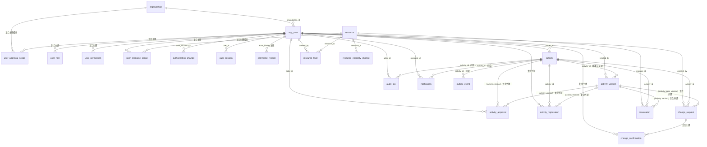

# 数据库设计文档（DS-01，对应 V1__schema.sql v3.0）

> 维护：黄方勇 55230315（设计师）。唯一权威是 [02-数据与接口契约](../../agents/common/02-数据与接口契约.md) §4（v3.0，2026-10-13）；本文只解释结构从何而来、约束为什么这样建、和"比契约更严的少数地方"。表定义见 `server/src/main/resources/db/migration/V1__schema.sql`。
>
> v3.0 变更记录：V1 首次形态（17 表，2026-10-13 本人分支）从未进入基线/合并 main，经核实 main 的 v3.0 契约（02 §7 规程、PM 组织一致更新）后**原地升级**，不产生 V2 补丁。升级内容见本文 §2/§8 与 migration-register.md。

## 1. ER 总览

22 张表、8 组核心关系；纯关系表 6 张（user_role、user_permission、user_approval_scope、user_resource_scope、activity_registration、change_confirmation）+ 两张授权/资格快照表（authorization_change、resource_eligibility_change）。



要点：
- `activity`(id, version_no) / (id, effective_version_no) 对 `activity_version` 的两条复合外键形成"活动↔版本"闭环，**均设为 DEFERRABLE INITIALLY DEFERRED**（契约 §4 明确要求），允许"同一事务创建活动及首版本"。
- 引用 `activity_version` 的全部复合外键（approval、registration、reservation、change_request.base）统一延迟，保证"activatePlan 与 replaceReservations 同事务"不受插入顺序影响。
- `user_resource_scope` 与 `resource_eligibility_change` 的 resource_id 外键因建表顺序在 resource 建表后以 ALTER 补加（同一迁移内完成，效果等同）。

## 2. v3.0 三角色、身份与资格（01 §2 → 表结构）

| 结构 | 取值/约束 | 语义 |
|---|---|---|
| `app_user.identity` | text NOT NULL，CHECK ∈ TEACHER/STUDENT | 独立于角色；教师身份不自动有审批权 |
| `user_role.role` | CHECK ∈ APPLICANT/APPROVER/ADMIN | 申请人无显式行也合法（所有人默认申请人能力不必写表） |
| `user_permission.permission` | CHECK ∈ USER_MANAGE/RESOURCE_MANAGE/RESOURCE_CONFIRM/AUDIT_READ | 仅随 ADMIN 角色生效（装载/授权由 PM 校验） |
| `user_approval_scope` | PK(user,organization,category) | 每行是一项明确（组织,资源类别）授权，无隐式通配 |
| `user_resource_scope` | PK(user,resource) | 资源管理及复核仅此集合；AccountPort.grantResource 在资源创建编排中追加 |
| `authorization_change` | before_json/after_json NOT NULL | 身份/授权/启停前后值，**与权限变更同一事务**（事务一致性由 PM 侧保证，表结构只保快照完整） |
| `resource_eligibility_change` | before_json/after_json NOT NULL | 资格前后值，**与资源修改同一事务**（DS-02 落实） |
| `resource.allow_teacher/allow_student` | boolean NOT NULL DEFAULT true | 四种组合均合法（01 §2），不再可变限制 |

写入归属：五张新表中 user_*、authorization_change 归 PM 写入，resource_eligibility_change 归 DS 写入；建表 SQL 统一由本模块出（契约 §4）。

## 3. 状态与枚举（CHECK 约束）

| 表.字段 | 取值 | 来源 |
|---|---|---|
| app_user/user_role | identity 两值；role 三值 | 02 §2、01 §2 |
| user_permission | 四权限值 | 02 §2 Permission |
| activity.status | DRAFT…CANCELLED 六值（v3.0：PENDING_TEACHER→**PENDING_APPROVER**） | 01 §3 状态机 |
| activity_registration.status | ACTIVE/WITHDRAWN/CANCELLED | 02 §2 |
| reservation.status | ACTIVE/RELEASED | 02 §4 |
| resource.kind / 关联 category | VENUE/EQUIPMENT；venue category 固定 VENUE | 02 §2 |
| change_request.status | 八值（PENDING_TEACHER→**PENDING_APPROVER**） | 01 §4 改期状态机 |
| activity_approval.decision、change_confirmation.decision | APPROVE/REJECT（后者可空=未回答） | 02 §2 |
| outbox_event.status | PENDING/DONE/FAILED；attempts 初始 0 | 02 §4 |

数量/版本一律 integer 且 non-negative CHECK（version_no ≥ 1，版本 0 仅 audit/outbox 允许）；区间一律 start < end；quantity > 0。

改期三待处理状态（唯一索引覆盖）同步改为：AWAITING_CONFIRMATIONS / PENDING_APPROVER / PENDING_RESOURCE。

## 4. resource 的"形状"约束

```sql
ck_resource_shape：
  (kind='VENUE' 且 capacity IS NOT NULL 且 capacity>0 且 quantity=1 且 category='VENUE')
  OR (kind='EQUIPMENT' 且 capacity IS NULL 且 quantity>0)
```

名称/类别/开放时间不可变（01 §4），故 01 契约级不变量写死在 CHECK；v3.0 中**资格两列是唯一可变的资源字段**（DS-02 修改入口），容量/数量的不可变约束保持。

## 5. 契约未明说、我按"更严"实现的 5 处（已登记，接受契约 §7 复核）

| 处 | 决策 | 理由 |
|---|---|---|
| activity_version 不可修改/删除 | 触发器 RAISE（等价 append-only） | 契约写明"写入后不修改" |
| change_request.target_plan_json 不可修改 | BEFORE UPDATE 触发器（仅拦截该列） | 契约写明"不可变 targetPlan" |
| audit_log 只追加 | 触发器拦截 UPDATE/DELETE | 契约写明"只追加" |
| notification.event_id 对 outbox_event **不加**外键 | 刻意不加 | 契约未列此外键；outbox 允许消费后归档清理，而通知是长期记录，两者生命周期不同 |
| resource_fault 的 venue quantity=1 | 未加触发器，由 DS-02 服务层校验 | 跨表规则；契约仅要求"start<end、数量正"入 CHECK |
| user_permission 与 ADMIN 角色的一致性 | 未加触发器，由 PM 授权校验/装载器保证 | 三角色授权规则属账号编排；QA 装载器已自检并拒绝违规数据 |

若评审认为以上任一项过严/过松，按 02 契约 §7 规程修改本文件并出 V2+ 迁移，**不回改 V1**。

## 6. 索引清单（契约 §4 全部 + 少量补充）

| 索引 | 作用 |
|---|---|
| `reservation(resource_id,start_at,end_at) WHERE status='ACTIVE'`（部分） | 冲突扫描主路径：按资源与时间窗取活跃预约 |
| `resource_fault(resource_id,start_at,end_at)` | 故障窗口与受影响清单查询 |
| `notification(recipient_id,created_at)` | 通知收件箱列表 |
| `activity(owner_id,status)`、`activity(organization_id,status)` | scope=mine / scope=review |
| `outbox(status,next_attempt_at)` | 通知消费者批量取事件 |
| `uq_change_request_pending_activity`（部分唯一：三个待处理状态） | **每活动最多一个待处理改期** |
| 补充：`uq_reservation_activity_version_resource`（亦是唯一约束） | 契约"每活动/版本/资源唯一" |
| 补充：`idx_authorization_change_user`、`idx_resource_eligibility_change_resource` | 授权/资格历史按主体检索 |
| 补充：`idx_auth_session_user`、`idx_activity_registration_user`、`idx_change_request_activity`、`idx_audit_log_activity_time`、`idx_resource_kind`、`idx_resource_category`、`idx_activity_approval_activity`、`idx_app_user_organization` | 各模块按 Key 检索 |

## 7. 时间与格式约定

- timestamptz 存 UTC（PostgreSQL 接收 offset，页面 Asia/Shanghai 由前端转换）；
- `open_from/open_to` 为 `time`（无时区，同日递增 CHECK）；
- JSON 字段 jsonb；数量/版本 integer；enabled/allow_* boolean；
- created_at/updated_at 全表 NOT NULL DEFAULT now()（契约"至少 created_at"的超集）。

## 8. 迁移与验证

- 全部结构在 `V1__schema.sql` 一次成型（v3.0 形态 22 表）；此后只**追加**已分配编号的 V2+，不改 V1（契约 §4）。
- 迁移验证结果与等价 SQL 烟测记录见 [migration-register.md](migration-register.md)；大意：2026-10-13 在 PostgreSQL 17（docker postgres:17，campus_test 独立 schema）单事务跑通 22 表 + 正负路径断言 + 提交期延迟外键 + 3 触发器。
