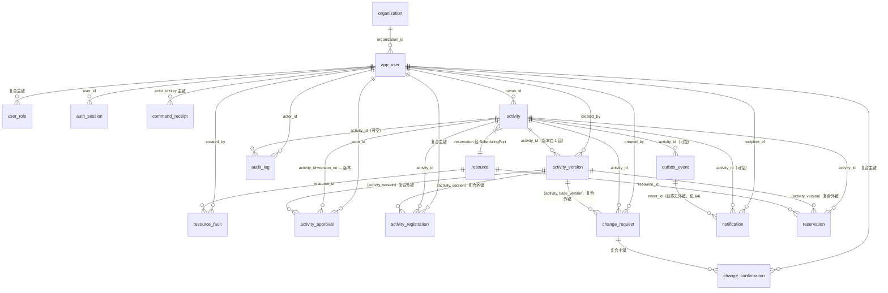

# 数据库设计文档（DS-01，对应 V1__schema.sql）

> 维护：黄方勇 55230315（设计师）。唯一权威是 [02-数据与接口契约](../agents/common/02-数据与接口契约.md) §4；本文只解释结构从何而来、约束为什么这样建、和"比契约更严的少数地方"。表定义见 `server/src/main/resources/db/migration/V1__schema.sql`。

## 1. ER 总览

17 张表、5 组核心关系；纯关系表 3 张（user_role、activity_registration、change_confirmation）+ 幂等回执（command_receipt）按复合主键组织。



要点：
- `activity`(id, version_no) / (id, effective_version_no) 对 `activity_version` 的两条复合外键形成"活动↔版本"闭环，**均设为 DEFERRABLE INITIALLY DEFERRED**（契约 §4 明确要求），允许"同一事务创建活动及首版本"。提交时完整校验，不削弱一致性。
- 引用 `activity_version` 的全部复合外键（approval、registration、reservation、change_request.base）统一延迟，保证 CM §6 的"activatePlan 与 replaceReservations 同事务"及 AN 的版本切换不受插入顺序影响。

## 2. 状态与枚举（CHECK 约束）

| 表.字段 | 取值 | 来源 |
|---|---|---|
| app_user/user_role | 五角色 | 02 §2 Role |
| activity.status | DRAFT…CANCELLED 六值 | 01 §5 状态机 |
| activity_registration.status | ACTIVE/WITHDRAWN/CANCELLED | 02 §2 |
| reservation.status | ACTIVE/RELEASED | 02 §4 |
| resource.kind / 关联 category | VENUE/EQUIPMENT；venue category 固定 VENUE | 02 §2 |
| change_request.status | 八值 | 01 §6 改期状态机 |
| activity_approval.decision、change_confirmation.decision | APPROVE/REJECT（后者可空=未回答） | 02 §2 |
| outbox_event.status | PENDING/DONE/FAILED；attempts 初始 0 | 02 §4 |

数量/版本一律 integer 且 non-negative CHECK（version_no ≥ 1，版本 0 仅 audit/outbox 允许）；区间一律 start < end；quantity > 0。

## 3. resource 的"形状"约束（一条 CHECK 表达合同式校验）

```sql
ck_resource_shape：
  (kind='VENUE' 且 capacity IS NOT NULL 且 capacity>0 且 quantity=1 且 category='VENUE')
  OR (kind='EQUIPMENT' 且 capacity IS NULL 且 quantity>0)
```

first 版不提供资源数量/容量修改与删除入口（01 §4），因此把"venue 恰 1"等不可变偏移量写死在 CHECK，服务层不再重复被绕过。`open_from < open_to` 同做 CHECK。

## 4. 契约未明说、我按"更严"实现的 4 处（已登记，接受契约 §7 复核）

| 处 | 决策 | 理由 |
|---|---|---|
| activity_version 不可修改/删除 | 触发器 RAISE（等价 append-only） | 契约写明"写入后不修改"；阻止 AN/CM 侧意外 UPDATE 造成历史失真 |
| change_request.target_plan_json 不可修改 | BEFORE UPDATE 触发器（仅拦截该列） | 契约写明"不可变 targetPlan" |
| audit_log 只追加 | 触发器拦截 UPDATE/DELETE | 契约写明"只追加" |
| notification.event_id 对 outbox_event **不加**外键 | 刻意不加 | 契约未列此外键；outbox 允许消费后归档清理，通知是长期记录，二者生命周期不同 |
| resource_fault 的 venue quantity=1 | 未加触发器，由 DS-02 服务层校验 | 跨表规则；契约仅要求"start<end、数量正"入 CHECK |

若项目经认为以上任一项过严/过松，按 02 契约 §7 规程修改本文件并出 V2+ 迁移，**不回改 V1**。

## 5. 索引清单（契约 §4 全部 7 条 + 少量补充）

| 索引 | 作用 |
|---|---|
| `reservation(resource_id,start_at,end_at) WHERE status='ACTIVE'`（部分） | 冲突扫描主路径：按资源与时间窗取活跃预约 |
| `resource_fault(resource_id,start_at,end_at)` | 故障窗口与受影响清单查询 |
| `notification(recipient_id,created_at)` | 通知收件箱列表 |
| `activity(owner_id,status)`、`activity(organization_id,status)` | scope=mine / scope=review |
| `outbox(status,next_attempt_at)` | 通知消费者批量取事件 |
| `uq_change_request_pending_activity`（部分唯一：三待处理状态） | **每活动最多一个待处理改期** |
| 补充：`uq_reservation_activity_version_resource`（也是唯一约束） | 契约"每活动/版本/资源唯一" |
| 补充：`idx_auth_session_user`、`idx_activity_registration_user`、`idx_change_request_activity`、`idx_audit_log_activity_time`、`idx_resource_kind/category`、`idx_activity_approval_activity`、`idx_app_user_organization` | 各模块按 Key 检索；列表上限 200 条，无明显要求时以足够过滤为先 |

补充索引是"使能项"不是热点路径；性能基线（300 候选搜索、20 并发）在 DS-04/QA 阶段用真实数据核对后再调整。

## 6. 时间与格式约定

- 所有 timestamptz 与 UTC 存储（PostgreSQL timestamptz 传 offset，页面 Asia/Shanghai 由前端转换）；
- `open_from/open_to` 为 `time`（无时区，同日递增 CHECK）；
- JSON 字段 jsonb；数量/版本/尝试次数 integer；enabled boolean；
- `created_at/updated_at` 全表 NOT NULL DEFAULT now()（含纯关系表，契约"至少 created_at"的超集，可接受）。

## 7. 迁移与验证

- 全部结构在 `V1__schema.sql` 一次成型；此后只**追加**已分配编号的 V2+，不改 V1（契约 §4）。
- 迁移验证结果与等价 SQL 烟测记录见 [migration-register.md](migration-register.md) 与 [handoff.md](handoff.md)。
