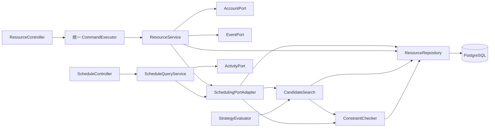

# 资源与调度实现及验证 v1.0

日期：2026-10-20；设计师黄方勇（55230315）；任务 DS-02～05。基准 main `4fbda0e`，代码提交 `91d3063`。本说明追加描述本轮实现，不重写已评审的系统/数据库设计基线，不修改 common 契约。

## 实现边界



SchedulingPort 不依赖 ActivityPort、AccountPort、EventPort 或上层 Service。最终确认从 Repository 读取活动所有者最新身份和当前版本预计人数；重要写操作的用户锁由 AN/CM 调用编排持有。资源新增仅通过 AccountPort.grantResource 写入创建者范围，DS 不直接修改授权表。

资源资格修改与故障登记均锁同一 resource 行。首次确认/改期确认锁新旧资源并集，按规范 UUID 字符串顺序逐行 `FOR UPDATE`，与 PostgreSQL UUID 顺序一致。确认检查排除本活动旧预约；资源缺失、身份不合资格、人数与存储版本不一致均失败。资格不足使用 403 RESOURCE_INELIGIBLE；容量冲突由 CheckResult 返回，供 CM 保存 CONFLICTED。

replaceReservations 必须在同一事务内取得相同计划的成功检查凭据；凭据随事务结束清理，挂起/恢复事务时也隔离。替换前核对目标不可变版本的计划和人数，再重查资格及容量；随后释放旧记录、插入全部新记录。任何 SQL/业务异常交由调用事务整体回滚。releaseReservations 使用相同资源锁序，重复释放无新增记录。端口写方法均为 MANDATORY，不创建独立提交事务。

风险通过现存 ACTIVE 预约与当前故障/其他占用动态计算。资格变更不删除旧预约，也不把资格变化本身视为容量风险。设备按同时峰值计算；重叠故障的可用量最低为 0，端点相接不冲突。

## 候选与评测

候选顺序为偏移 `0/-30/+30/-60/+60/-90/+90/-120/+120` → 场地 UUID → 原设备组合优先及单项同类替换。保留时长、布撤场和设备数量，排除重复 ID，先过滤两类身份资格。最多检查 300 个完整组合；跨日偏移计入检查预算但被拒绝。去重后按 common/01 的六项代价排序，最多返回 5 项。

FIRST_FIT 与 RANKED 使用同一生成器、检查器和预算；前者在首个可行组合停止，后者检查完预算再排序。评测方法在同一 PostgreSQL REPEATABLE_READ 事务中运行两策略，避免比较过程中读到不同数据库状态；每个计时分别包含自己的资源读取、候选生成、检查及选择，结果严格两项。

`ResourceSchedulingIT.calendarTruncationAndCandidateBudgetUseRealRows` 在真实库构建 38 个场地、1 类设备和故障数据，验证 300 上限、5 个结果、截断与不写预约；再以预计人数 10000 的无解请求让两策略都扫描满 300 次，各预热一次、实测十次。原始 [ds-budget-evaluation.json](../../artifacts/test-results/ds-2026-10-20/ds-budget-evaluation.json) 含资源和请求数据、策略、可行性、choice、评测数及纳秒耗时。

| 策略 | 实测轮数 | 每轮检查数 | 中位数 ms | 最小 ms | 最大 ms |
|---|---:|---:|---:|---:|---:|
| FIRST_FIT | 10 | 300 | 126.59 | 115.51 | 204.71 |
| RANKED | 10 | 300 | 125.01 | 115.60 | 295.87 |

这只是单个无解预算场景；不能将它当作 QA 八场景评测、响应时间 SLA 或全局最优证明。当前正式八场景入口实际失败于 QA 参考数据装载，尚无该入口生成的结果。

## API 与依赖

| API | 实现/当前限制 |
|---|---|
| 07 资源列表 | 数据库过滤 kind/category；读取 201 条并返回最多 200 条、truncated |
| 08 创建资源 | 真实写入，与创建者资源范围授权同事务；共享幂等入口 |
| 09 日历 | 同一预约拆布场/主体/撤场，附故障；最多 7 天、201 条检测截断；无权活动仅“已占用”、activityId=null，故障原因不公开 |
| 10 登记故障 | 范围授权、单条数量限制、真实故障/影响查询、EventPort 事件编排；main 缺 EventPort 时 503 且不提交 |
| 11 故障列表 | 需要 RESOURCE_MANAGE 和对应资源范围；影响清单携带当前风险 |
| 40 资格变更 | 用户锁→资源锁；资格前后值与更新同事务；保留既有预约 |
| 24/25 预览/候选 | 独立查询服务通过 ActivityPort 取版本，校验所有者或完整审批范围、最新身份；main 缺 ActivityPort 时 503 |

缺失端口通过 ObjectProvider 延迟解析并明确失败，目的是让可独立运行的资源/调度模块可启动；没有空实现或伪成功。API-10/24/25 的端到端成功验收仍待 CM/AN 交付真实端口。

## 实际验证与复现

环境为 Windows、Java 21.0.6、Maven 3.9.11（仓库 Wrapper）、Spring Boot 3.5.16、PostgreSQL 17.6。数据库是本轮下载便携二进制启动的本机独立 `campus_test`（5440），不是开发库；不修改 `.env`，不安装系统服务。只使用各测试自己生成的 `t_<UUID>` schema，测试结束清理并停止进程。

默认入口实际执行过，失败于 main 的 CM 编译问题：

```powershell
./server/mvnw.cmd -f server/pom.xml test
# 同样通过 Git Bash 执行 Unix Wrapper，Java 21 下复现：
./server/mvnw -B -ntp -f server/pom.xml test
```

为继续验证 DS，在 `server/target/ds-build/pom.xml` 复制共享 pom，明确设置原生产/测试/资源绝对路径，只给 compiler 增加 `com/campus/events/dev/**` 排除；默认构建未被修改。实际生成的 [isolated-pom.xml](../../artifacts/test-results/ds-2026-10-20/isolated-pom.xml) 是本机证据，路径需按接收人工作区调整。使用相同依赖、所有测试源码、JUnit/Surefire/Failsafe，没有跳过测试或降低版本：

```powershell
. ./scripts/load-env.ps1
# 本轮测试进程内覆盖连接地址，不修改.env；账户和口令仍由白名单装载器读取。
$env:TEST_DATABASE_URL='jdbc:postgresql://127.0.0.1:5440/campus_test'
$env:JAVA_HOME='/d/Java_jdk'
$env:MAVEN_USER_HOME='/c/Users/35049/Desktop/campus-sched/server/target/maven-home'
& 'D:/Git/Git/bin/bash.exe' ./server/mvnw -B -ntp `
  -f server/target/ds-build/pom.xml `
  '-Dmaven.repo.local=C:/Users/35049/Desktop/campus-sched/server/target/maven-repository' `
  '-Dtest=CandidateRankingTest,CapacitySweepTest,TimeIntervalTest,StrategyEvaluatorTest,ScheduleQueryServiceTest' `
  '-Dit.test=ResourceSchedulingIT,SchemaIT' verify
```

实际结果：23 项单测和 25 项 IT 全部通过，退出码 0。SchemaIT 仅修复自己的测试：排除 Flyway 元数据表、用例间独立清理组织和资源、活动/版本同事务装载、显式 JSONB 转换、补齐预约版本参数；V1 没有重做或修改。每条业务拒绝断言仍核对 SQLSTATE 与约束名。

| 范围 | 场景与证据 |
|---|---|
| DS-02 / N-AT-02～04 的模块层 | 两类身份×四种资格×场地/设备；最新身份/资格重查；资格更新持锁期间另连接确认确实等待，提交后拒绝；旧预约保留 |
| DS-03 / D-AT-04～06 | 半开区间、布场重叠、设备相邻负载峰值、故障可用下限、小时/人数硬约束 |
| DS-04 / D-AT-07/12/13/14 的端口层 | 两个独立连接/事务通过 CyclicBarrier 同时抢场地/设备恰一成功；输方无部分预约；排除自身；预约插入中途触发器异常恢复旧预约/版本 |
| 风险/隐私/权限 | 实时 AT_RISK、故障影响、日历三段与故障、200 项截断、真实登录及 HTTP 统一幂等、越范围拒绝 |
| DS-05 | 资格过滤、同类替换、稳定排序、0/5 项、300 截断、两策略原始测量 |

模块测试替身仅存在于单测或测试局部构造中；生产资源 Repository、SchedulingPort、数据库、锁与事务均真实。没有宣称活动/改期/outbox 跨模块全链路已验收。

证据目录：[ds-2026-10-20](../../artifacts/test-results/ds-2026-10-20/)。源文件 SHA-256 与代码 commit 在 [source-manifest.json](../../artifacts/test-results/ds-2026-10-20/source-manifest.json)，包括 V1 哈希。日志归档仅去除行尾空白以通过 diff 检查，没有改动测试结果或耗时。报告只保存文本和实际原始数据，未提交密码、构建缓存或数据库文件。

## 尚未解决的外部集成问题

1. **CM 编译修复尚未进 main**：`DemoDataSeeder.java:118` 未处理 Exception，默认 test 在生产编译停止；现成修复位于 `origin/fix/demodataseeder-118`。见 [default-test.log](../../artifacts/test-results/ds-2026-10-20/default-test.log)。
2. **AN 既有单测失败**：首次隔离全部单测 48 项中 1 项失败，`ActivityStateMachineTest:49` 对未修改的 pending 值期待异常；DS 未修改该测试。见 [initial-all-unit-tests.log](../../artifacts/test-results/ds-2026-10-20/initial-all-unit-tests.log)。
3. **QA 八场景实际失败**：在隔离 pom 下选择 `-Dit.test=SchedulingBenchmarkIT`，用 `test.data.dir` 指向仓库 test-data、数据源 `currentSchema=${test.schema.name}` 绑定 QA 随机 schema；仍在 `DbTestSupport:236` 先写资源范围而资源尚未创建时触发外键错误。见 [qa-benchmark.log](../../artifacts/test-results/ds-2026-10-20/qa-benchmark.log)。远端 `work/55230316-qa` 已有 `0bb9aac` 装载修复，需交叉评审合入后再复验，不直接改他人文件。
4. **AN/CM 业务端口尚缺**：ActivityPortAdapter、EventPort 及完整首次确认/改期/取消编排未到位，API-10/24/25 的成功链路和 M2/M3 仍待接收人完成。

交接与接收人见 [handoff](handoff.md)。未获其他成员评审前不标记“评审放行”，不合并 main。
