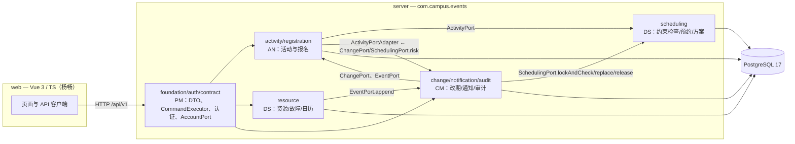
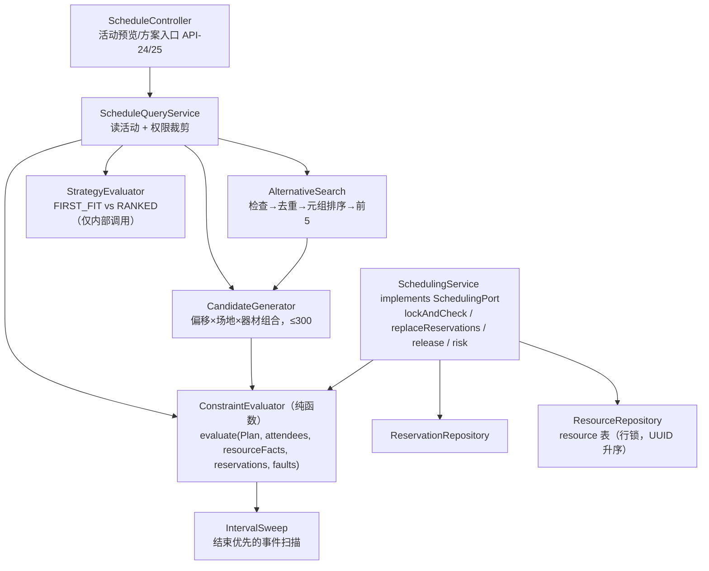
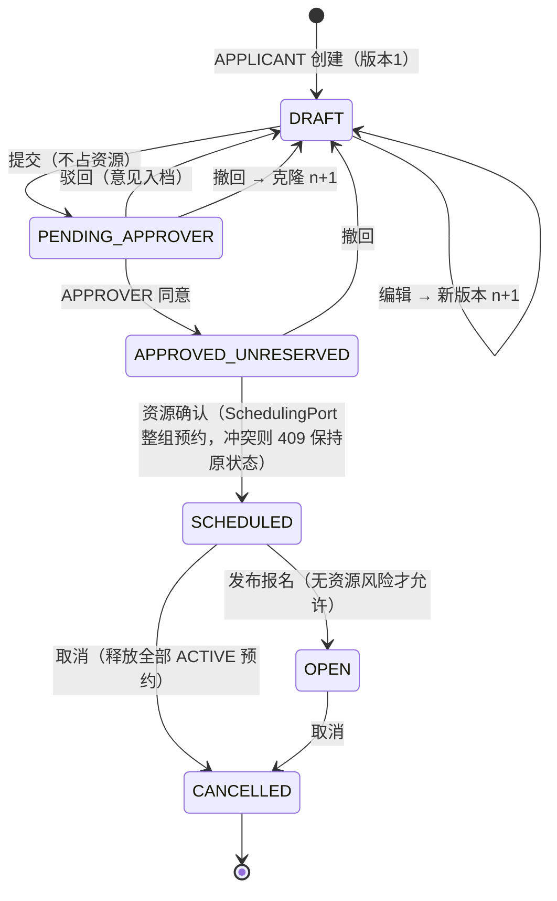
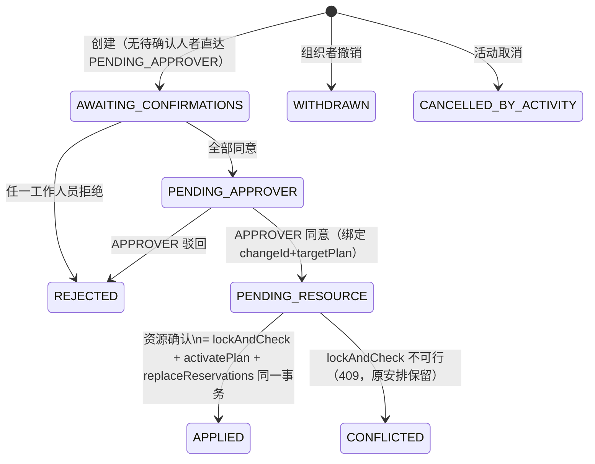
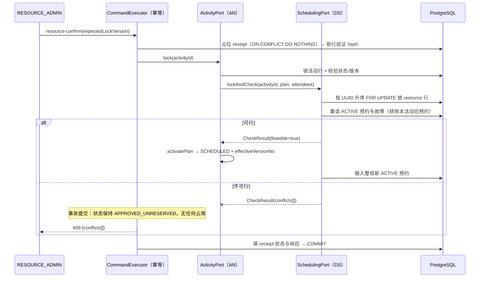

# 系统设计文档（v0.2 草稿——DS-01 范围，v3.0 契约）

> 维护：黄方勇 55230315（设计师）。本文档随交付逐步充实，当前覆盖 DS-01：统一数据库结构与设计模型。v3.0 采用三角色（APPLICANT/APPROVER/ADMIN）、独立身份（TEACHER/STUDENT）与资源资格（allowTeacher/allowStudent，四组合均合法）。
> 全文体系为 Mermaid 图源（可直接编辑），不提供外部链接占位。

## 1. 系统模块图

单一 Spring Boot 后端按业务包拆分，包间仅通过 `contract/` 中定义的端口调用，禁止跨包直改他人表。

## 2. 调度模块（scheduling）内部结构

SchedulingPort 实现只依赖 resource/scheduling 自己的 Repository，不依赖 ActivityService（防循环依赖）；预览 Controller 若需 ActivityPort，放在独立查询 Service，不注入 SchedulingPort 实现。

## 3. 活动状态图（AN 主流程中与调度相关的边界）

## 4. 改期状态图（CM 驱动，调度端口在两处接入）

> v3.0 资格规则：所有场地和设备按**活动所有者最新身份**校验（覆盖提交、候选、改期创建和最终确认）；SchedulingPort 各方法签名包含 `Identity applicantIdentity`。已生效预约保留，未确认申请及改期目标用最新资格（01 §2）。

## 5. 首次资源确认时序（成功与失败路径）

## 6. 数据库设计

**由 designers 单独成篇**：见 [database-design.md](database-design.md)（17 表模型、约束与索引取舍）与 [migration-register.md](migration-register.md)（迁移版本登记）。本文档不再重复表定义。

## 7. 尚未覆盖的内容（后续 DS-02~05 补充）

- 资源/故障/日历（DS-02）的服务细节与 API-07—11 权限矩阵——待实现完成补写。
- 纯约束检查的类型与缺口报告格式（DS-03）——待 ConstraintEvaluator 定型补写。
- 替代方案搜索边界与策略比较结论（DS-04）——评测数据产生后补写实测结果。
- 设计取舍的"为什么"记录随 DS-05 交接一并列出。
