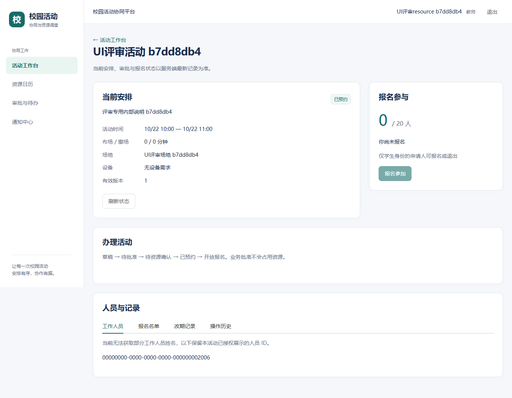
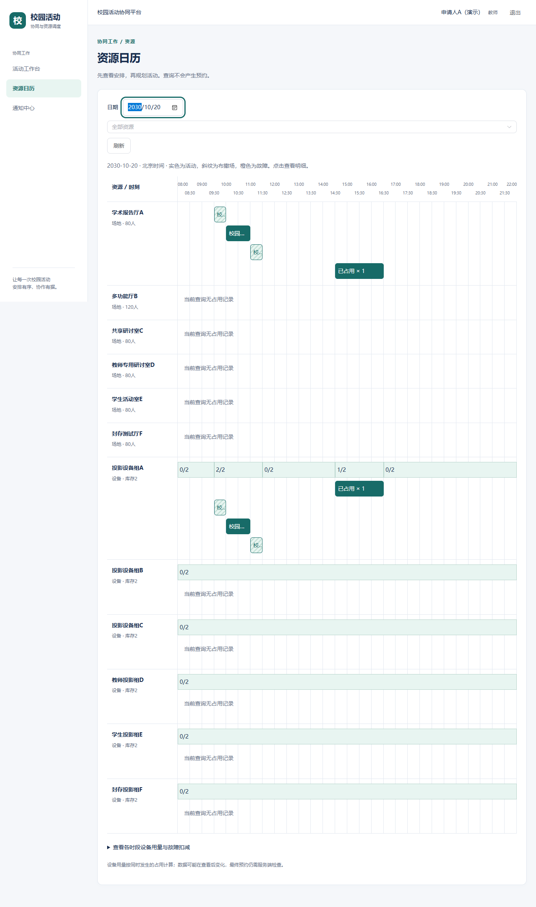

# 校园活动协同与资源调度系统用户手册

姓名 杨畅　学号 17231018

本手册面向活动申请人、批准人、资源管理员、账号管理员以及活动工作人员，说明如何使用系统完成活动申请、预约、报名和改期。按本人职责阅读对应章节，操作后以详情页刷新所得状态为准。

截图来自隔离测试环境，账号、资源及活动均为演示或测试数据，不提供真实账号密码。

## 1 使用须知

### 适用范围

系统用于单个校园、多组织的活动协同和资源调度。覆盖账号与权限、场地与设备、活动草稿、审批、联合预约、发布、学生报名、改期确认、资源故障、通知与历史。首版不提供签到、支付、短信通知、统一身份登录或全局最优排程。

本手册按当前已实现页面编写。实际菜单取决于账号授权；未出现某个入口不一定是故障。业务权限、状态和资格均由服务器最终检查，不应通过更换链接或修改浏览器数据绕过。

### 开始前准备

1. 向本项目管理员取得系统访问地址、已启用的账号和初始密码，确认所属组织、教师或学生身份及办理职责。
2. 使用能运行现代网页的浏览器访问。当前本地验证使用Microsoft Edge；其他浏览器及正式部署环境仍应按发布验收结果确认，不承诺所有版本兼容。
3. 操作前准备活动名称、公开简介、未来的起止时间、预计人数、报名容量、场地设备和工作人员。
4. 确保网络可用。不要在带有“演示数据 / 未连接后端”标识的开发预览中办理真实业务。

系统业务时间统一为北京时间。活动、布场和撤场的完整占用应在同一天，且处于资源开放时段内。截图中的2030年日期属于测试环境固定日期，真实使用时应选择实际未来时间。

### 阅读与使用约定

本手册用中文引号表示页面按钮或栏目；“所有者”指该活动的申请人。“刷新”指页面提供的刷新按钮或浏览器刷新，操作后应核对最新安排和状态。

操作步骤中的成功标准用于帮助用户确认结果，不代表所有功能已通过完整项目验收。当前已知限制见第15章；部署、启动和联调环境说明放在第16章，普通用户不需要安装开发工具。

### 信息保护

仅在活动公开简介中填写可以公开的信息，不写密码、证件、私人联系方式或保密审批内容。不要转发账号密码、会话令牌或完整人员名单。共享电脑使用结束后点击“退出”，确认返回登录状态。

向管理员反馈问题时提供活动或改期编号、操作时间、错误提示和追踪编号；截图应遮去无关个人信息。用户手册不预设学校已经批准的管理制度，实际流程责任由项目负责人确认。

## 2 角色权限与页面导航

### 身份和角色如何区分

教师和学生是独立身份，决定相关资源的申请资格。申请人、批准人和管理员是业务角色。教师身份不会自动获得审批权；管理员也不会自动获得全部管理权。一个账号可以具有多个角色，但所有者不能批准或资源复核自己的活动及改期。

| 使用者 | 可以办理的主要事项 | 必要条件 |
|---|---|---|
| 申请人 | 创建和管理本人活动，申请改期、取消 | 已启用且具有申请人角色 |
| 学生申请人 | 对开放活动报名或退出 | 学生身份和申请人角色同时具备 |
| 批准人 | 首次审批、改期复审 | 审批组织和资源类别范围完整覆盖，且不是所有者 |
| 资源管理员 | 创建资源、设置资格、登记故障 | 资源管理权限及对应资源范围 |
| 资源复核管理员 | 首次联合预约、改期最终确认 | 资源复核权限覆盖全部目标资源，且不是所有者 |
| 账号管理员 | 创建账号、启停、编辑完整授权 | 账号管理权限 |
| 审计查看人员 | 查看授权活动操作历史 | 审计权限及对应资源范围 |
| 工作人员 | 对分配给自己的改期安排进行确认或拒绝 | 属于该活动且当前有本人待确认步骤；不是独立业务角色 |

### 找到操作入口

| 页面入口 | 使用目的 | 进入方式 |
|---|---|---|
| 活动工作台 | 查看活动、创建申请、进入详情 | 登录后首页或左侧菜单 |
| 资源日历 | 查询占用、故障和设备用量 | 左侧菜单 |
| 审批与待办 | 处理首次审批、资源确认及改期 | 具有相应授权时显示 |
| 通知中心 | 阅读通知并进入关联事项 | 左侧菜单 |
| 资源管理 | 创建资源、修改资格、登记故障 | 资源管理权限下显示 |
| 账号与授权 | 创建账号、启停及授权 | 账号管理权限下显示 |
| 改期工作台和改期进度 | 提交目标方案和处理确认 | 活动详情“发起改期”或“改期记录” |

手机上先点击顶部“菜单”。部分管理内容较多，建议用桌面完成完整授权和复杂排程，手机主要用于查看活动、通知和确认步骤。

## 3 登录与活动工作台

### 登录和退出

1. 打开管理员提供的系统地址，进入登录页，输入用户名及密码，点击登录按钮。
2. 成功后进入活动工作台或原先访问的受保护页面，核对顶部显示的当前账号及身份。
3. 如提示账号或密码错误、账号不可用或网络失败，停留在登录页处理原因。系统不会在认证失败时假装登录成功。
4. 使用结束后点击右上角“退出”。如果退出请求失败，按页面提示处理，不能只凭点击动作判断会话已结束。

当前前端没有自助注册、找回密码或修改密码入口。无法登录时联系账号管理员，由其核实账号启用状态和授权，并安排凭据问题的处理；不要寻找本手册未提供的按钮。

会话保存在当前浏览器标签页。刷新会重新查询账号；过期或失效后需要重新登录。不同标签页的登录状态可能不同，操作前核对当前账号，避免用错身份。

### 查找活动

有申请人角色时，可在“我的活动”和“公开活动”之间切换，再按状态筛选。“我的活动”涵盖当前账号按关系有权读取的活动，不能简单理解为只有本人创建的记录；公开列表以实际授权结果为准。

点击活动卡片进入详情，重点查看活动时间、当前状态、资源风险和报名人数。点击“刷新”重新查询；没有记录与查询失败是不同状态。如果页面提示仅返回部分数据，当前筛选只针对已加载内容，不能据此判断活动不存在。

### 第一次办理的阅读顺序

活动申请人按“创建草稿 → 检查资源 → 提交审批 → 等待业务批准 → 等待联合预约 → 发布活动”办理；学生在活动开放后报名。批准人阅读第6章，资源管理员阅读第9章，工作人员阅读第11章，账号管理员阅读第13章。

业务批准并不占用资源；点击候选方案也不代表预约成功。首次预约成功应看到“已预约”，改期成功应看到“改期已生效”及更新后的当前安排。

## 4 创建活动草稿

### 填写前检查

使用已启用的申请人账号进入“活动工作台”，点击“创建活动”。表单分为“基本信息”“时间资源”“工作人员”“检查保存”四步，用“下一步”和“上一步”切换。切换步骤不是保存，完成最后一步前不要关闭页面。

### 逐步填写

1. 基本信息：填写标题和公开简介，设置预计人数、报名容量。
2. 时间资源：选择未来开始和结束时间、布场及撤场时长、场地和所需设备；添加设备时填写数量，不重复选择同一资源。
3. 工作人员：从有权查询的本组织启用账号中选择需要参与活动确认的人员。人员候选查询失败时先处理错误，不能以空列表代替成功查询。
4. 检查保存：逐项核对，点击“保存草稿”。成功后进入有真实活动编号的详情页，再刷新确认草稿仍存在。

| 输入项 | 当前规则 | 填写提示 |
|---|---|---|
| 活动标题 | 1至100字 | 使用可识别的活动名称 |
| 公开简介 | 不超过2000字 | 不填写保密审批或私人信息 |
| 预计人数与报名容量 | 预计人数不小于报名容量，容量至少1 | 场地容量应足够容纳预计人数 |
| 活动时长 | 30分钟至6小时 | 开始和结束按北京时间填写 |
| 布场和撤场 | 各0至120分钟 | 完整占用不能跨上海自然日 |
| 场地和设备 | 开放区间、库存和申请资格均满足 | 标注“当前身份不可申请”的资源不可选择 |
| 设备数量 | 正整数，同一资源不重复 | 可用数量最终以资源确认时为准 |

### 成功标准和常见处理

成功标准是进入草稿详情，显示正确标题、安排及草稿状态，刷新后保持。保存草稿不占资源，也不代表审批完成。

字段错误按提示修正后再次保存。若保存结果未知，表单可能被锁定；使用页面提供的原请求重试，先查明结果，不要另建一份活动。若已提示保存成功但详情刷新失败，只重新查询，避免重复创建。

## 5 编辑草稿与检查资源

### 修改和保存

本人草稿详情显示“编辑草稿”。点击后调整信息、资源或工作人员，再保存。发生版本冲突时，保留的输入不等于已经保存；先核对最新版本和他人操作，再决定是否重新提交。已预约活动不从草稿编辑入口改时间或资源，应走改期流程。

### 检查资源和选择候选

1. 在已经保存的本人草稿详情点击“检查资源”。预览只读取资源情况，不建立预约。
2. 有冲突时查看具体资源、发生区间、需求数量、可用数量和原因。资格限制以活动所有者的最新教师或学生身份判断。
3. 若返回候选，可查看最多5项方案，选择2至3项进行比较，关注时间偏移、场地变化、设备替换及可行状态。
4. 选择候选后，方案会填入草稿编辑器。核对并保存修改，再重新检查资源、提交审批，不能把“选中”当成已经生效。

没有候选不等于不存在任何可行安排；搜索有范围和数量限制，不承诺全局最优。可调整时间、场地、设备或规模后重新检查。预览后若其他人抢先预约，最终确认仍可能发生冲突。

### 查看具体原因

| 提示类型 | 用户应检查的内容 |
|---|---|
| 场地容量不足 | 预计人数与场地容量是否匹配 |
| 不在开放时间 | 活动连同布场和撤场是否全部在开放区间 |
| 场地已占用 | 冲突时段与现有占用是否重叠 |
| 设备数量不足 | 同时占用的设备数量，而不是全天用量总和 |
| 资源故障 | 故障时段及不可用数量是否影响活动 |
| 申请资格限制 | 活动所有者身份是否满足每一个场地和设备的资格开关 |

刷新资源资格后，服务端最新设置会替换尚未保存的资格输入；活动申请也应按最新限制检查。原有生效预约的保留规则见第9章。

## 6 提交审批与首次资源预约

### 申请人提交

在本人草稿详情核对内容和资源检查结果，点击“提交审批”。成功后状态为“待批准”。如需调整，且页面仍提供“撤回为新草稿”，填写真实原因再撤回；新草稿仍需重新提交审批。

### 批准人处理

1. 从“审批与待办”进入活动，核对组织、活动安排、人数和全部资源类别是否在本人审批范围。
2. 同意时点击“批准”，意见可以留空，也可以填写真实说明；空意见和仅空白意见已经完成当前基线的真实回归。
3. 不同意时填写原因再点击“驳回”，活动返回草稿供所有者调整。不要用无意义空格代替必填拒绝原因。
4. 刷新核对结果。批准成功后显示“待资源确认”，此时尚未占用资源。

### 资源复核管理员处理

拥有全部目标资源复核范围且不是所有者的管理员，进入待资源确认活动，核对最新资格、占用、库存和故障，点击“确认联合预约”。联合预约应全部成功或全部失败，不由用户逐项拼凑确认。

成功标准：状态变为“已预约”，详情显示有效版本和安排，日历可查对应占用。资源确认失败时保留页面原因，交所有者调整；业务批准不保证资源一直空闲。

图1取自真实服务联调结果。读图时核对“已预约”、有效版本和当前安排；示例名称和日期仅用于测试。

## 7 发布报名撤回与取消

### 发布活动

所有者在“已预约”、活动尚未开始且没有资源风险时点击“发布活动”。成功后为“开放报名”。如果按钮不可用，先查看时间、风险提示和当前状态，不能用业务批准代替预约。

### 学生报名和退出

1. 使用学生身份且具有申请人角色的账号，在公开活动列表找到活动，进入详情核对当前安排。
2. 在“报名参与”区域查看容量与真实报名人数，点击“报名参加”。成功后本人状态变为已报名，按钮显示“退出报名”。
3. 如需退出，在允许退出的状态下点击“退出报名”，刷新后核对本人已不在有效报名状态。
4. 活动已开始、未开放、满额或正在处理改期时，按页面原因处理；满额阻止新报名，已报名者能否退出仍按状态判断。

改期处理中报名和退出均暂停。工作人员确认职责与学生报名资格是两回事；收到通知不代表已经报名，也不会自动确认改期。

### 撤回和取消的区别

| 操作 | 适用入口 | 结果和注意事项 |
|---|---|---|
| 撤回为新草稿 | 本人待批准活动详情 | 必须填写原因，生成可重新办理的草稿，后续需重新提交 |
| 撤回改期 | 本人待处理改期详情 | 必须填写原因并确认，本次改期终止，原有效安排保留 |
| 取消活动 | 本人活动详情且活动未开始，按可用入口办理 | 填写原因并二次确认；成功后不可恢复，不等于删除历史 |

取消成功应显示“已取消”；相关待处理改期关闭，有效报名取消，预约释放。刷新活动详情及资源日历核对结果。若取消结果未知，先原请求重试或重新查询，不要反复新建取消请求。

### 完成后的核对清单

所有者核对活动状态、安排和风险；报名者核对本人状态及最新活动时间；管理员核对资源日历。关键结果应保留在详情中，不能只凭一条短暂提示判断完成。

## 8 查询资源日历

### 查询和读图

1. 从“资源日历”进入，选择日期和资源，等待查询完成。
2. 桌面日历按资源行展示08:00至22:00的半小时刻度，观察布场、活动、撤场和故障图例。刻度是显示尺度，实际占用按分钟判断。
3. 点击占用块查看明细；有权限且有活动入口时可进入详情。无权限活动可能只显示已占用，不显示标题和私有链接。
4. 查询结果提示截断时，未显示的记录不能认为空闲；调整查询范围或联系管理员核实。

### 理解设备用量

设备“已用/总量”按同一时段的同时用量计算，不能把不同时段的预约数量直接相加。展开用量明细可核对预约及故障扣减后的可用上限，可用量最低为0。

例如同一设备10:00至11:00用2台，11:00至12:00用2台，端点相接不按同时4台计算；若另有故障，仍应核对相应时段的可用库存。日历仅反映当前查询结果，最终预约以联合确认为准。

图2取自隔离环境的真实日历。手机端采用列表形式，可逐条查看日期、资源、时段、数量和风险；不要仅凭颜色判断状态。

## 9 资源创建资格与故障管理

### 创建资源

具有资源管理权限的管理员进入“资源管理”，打开新增资源表单，填写类型、名称、资源类别、开放时间以及场地容量或设备库存，点击“创建资源”。场地数量为1且应填写容量；设备按实际库存设置正整数。

创建成功后刷新资源和本人权限，选中新增资源核对数据。只有位于本人管理范围内的资源可以继续办理；只读标识不是保存故障。当前首版未提供资源删除、任意修改资源基础信息或故障删除入口，不应按其他软件的习惯寻找这些操作。

### 修改申请资格

1. 选中本人可管理的资源，查看“允许教师申请”和“允许学生申请”。两项可以分别开启或关闭，也可以同时关闭。
2. 核对影响后点击“保存申请资格”，完成确认。
3. 成功后刷新并核对两个开关。点击“刷新资源与权限”成功时，最新设置会替换当前尚未保存的资格输入。

资格变化保留已生效预约，尚未确认的申请和改期目标按最新资格重新检查。所有资源都按活动所有者身份判断，不由审批人身份代替。刷新失败时保留输入并禁止保存，先恢复查询。

### 登记故障及后续处置

选中资源后填写故障开始、结束、不可用数量和原因，点击“登记故障”并确认。数量不能超过该资源库存，结束应晚于开始。选择查询日期查看故障记录及当前权限可见的受影响活动。

故障会减少可用数量并标记活动资源风险，原预约不会被自动删除。负责人员应查看风险、联系活动所有者评估改期或取消；不能把故障登记理解为已经完成改期。当前没有已加载故障记录时，还应确认查询成功，不能将查询失败当作无故障。

错误登记或需要撤销故障时，保存记录编号和原因，联系资源负责人按项目维护流程处理；当前页面没有解除故障按钮，不通过直接改数据库的方式教导普通用户处理。

## 10 创建改期申请

### 发起条件

活动所有者可在已预约或开放报名、尚未开始且无其他待处理改期时，从详情点击“发起改期”。原有效安排继续显示，新目标在最终确认前不替换原安排。改期目标必须在未来，并满足全部资源资格、时长、开放时段和容量限制。

### 预览方案

1. 在改期工作台调整时间、场地、设备等目标信息。
2. 点击“预览最终目标”，查看具体冲突及候选方案。候选最多5项，可选2至3项比较；排序首选不等于全局最优。
3. 选择候选后，系统会再次预览最终目标。核对实际填入的时间、场地和设备，不能仅凭候选卡片颜色判断可用。
4. 查看原新安排差异及四组影响：资源、审批、工作人员、报名与通知。注意需要本人确认的工作人员人数及报名人数。

### 创建申请

填写真实改期原因，核对最终目标与影响后点击“确认影响并创建改期”。修改目标输入或刷新活动版本会使旧预览失效，应重新预览再创建。

成功后进入改期进度，显示申请的新安排和当前阶段；原有效安排仍应保持。活动进入待处理改期时，学生报名和退出冻结。目标和影响快照不能直接修改，需要换方案时先撤回，再重新创建。

### 可行示例

某未来日期的原活动为10:00至11:00，需要改到12:00至13:00。所有者先核对目标场地和设备、预览冲突、比较候选、查看工作人员及报名通知影响，再创建申请。其他工作人员确认、批准人复审、资源管理员最终确认后，才以12:00至13:00作为当前有效安排。

若目标在最终确认时被其他活动抢占，改期可能变为资源冲突，原10:00至11:00安排应保留。若原资源本身有故障，保留原安排不代表风险已经解除，应同时查看风险提示。

## 11 处理改期与核对生效

### 按本人职责处理

| 当前阶段 | 操作者与按钮 | 操作要求和成功判断 |
|---|---|---|
| 等待工作人员确认 | 对应工作人员，“确认本人安排” | 核对原新时间及资源，只处理本人步骤，不能代签其他人 |
| 等待批准人复审 | 范围完整且非所有者的批准人，“批准改期” | 重新核对新目标、影响和意见，处理后进入后续阶段 |
| 等待资源确认 | 覆盖全部目标资源且非所有者的管理员，“确认全部资源并生效” | 核对最新冲突、资格和库存；全部确认成功才生效 |

打开改期详情后先刷新，查看“处理当前步骤”。没有本人可处理步骤时可能仅能查看，不应把其他人的待办当作自己的权限。

没有其他工作人员时，创建改期后直接进入批准人复审；所有者兼任工作人员也不需要确认自己。若还有其他工作人员，只由这些人员分别确认本人安排，所有者不能代签。旧申请若仍停在所有者确认步骤，不要反复尝试自签；由所有者撤回后重新预览、创建，并让其他工作人员重新确认。

### 拒绝和撤回

任何有权处理当前步骤的人员如不同意，点击“拒绝”，在弹窗填写原因，再点“确认拒绝”；“返回”用于放弃该次拒绝操作。所有者需要终止待处理申请时，填写原因，点击“撤回改期”并确认。

拒绝或撤回终止本次改期，保留原有效安排，解除该改期导致的报名冻结；报名能否继续仍取决于活动是否开放、是否已开始等条件。

### 核对最终结果

1. 成功后应显示“改期已生效”，刷新活动详情检查有效版本和新安排。
2. 打开资源日历，核对新时段占用；同时核对报名状态和通知内容，避免只看时间线最后一步。
3. 资源冲突时查看原因和冲突区间，原安排应保留，必要时重新规划。
4. 若仍有资源风险，风险条会持续显示。旧改期快照中的风险说明不能替代当前活动的实时风险。

通知尚未投递并不等于改期失败，最终以活动和改期详情的服务端状态为准；持续缺少通知时按第14章反馈。

## 12 通知与人员历史记录

### 阅读通知

从“通知中心”查看消息，可按未读状态筛选。核对活动、版本、内容和时间，使用关联入口进入详情后再办理相应事项。点击“标为已读”仅修改阅读状态，绝不代替工作人员确认、审批、资源确认或报名。

收到旧版本消息时，先打开详情并刷新当前状态，不要把通知文字中的历史安排当成当前安排。查询失败时应看到错误提示，不能把空白页面当成没有通知。

### 查询人员与记录

活动详情的“人员与记录”包含工作人员、报名名单、改期记录及操作历史等页签，是否可读取由当前账号授权决定。

| 记录 | 阅读方法及边界 |
|---|---|
| 工作人员 | 姓名不可查询时可能只显示授权人员ID，这是权限裁剪，不应自行推测姓名 |
| 报名名单 | 仅授权人员可见；报名总人数以页面真实计数为准，不能用可见名单长度推算 |
| 改期记录 | 点击后查询，进入待处理或历史改期；无权限应显示错误，不能当作暂无记录 |
| 操作历史 | 查看有权读取的操作、版本、人员及说明，用于核对办理经过 |

普通工作人员即使看不到完整人员数组，也可通过改期记录入口尝试查询其有权查看的历史；最终权限以服务端结果为准。纯批准人或跨组织角色看到人员ID时，不需要为显示姓名而随意追加申请人角色。

### 保护与留存

不要批量转发报名名单或工作人员信息。当前页面没有通用名单导出、审计下载或删除历史功能，不应把截图当成正式授权导出。业务数据的备份、保留期限及恢复由项目运维和管理制度另行确定，本手册不承诺未经确定的保留期限。

## 13 账号创建启停与完整授权

### 新建账号

具有账号管理权限的管理员进入“账号与授权”，点击“新建账号”，填写用户名、显示名、初始密码和所属组织，分别配置身份和角色。密码至少8个Unicode字符且不超过72个UTF-8字节；含中文或表情时，字符数和字节数不同，超限按表单提示调整。

按岗位需要配置授权，核对摘要并勾选完整授权确认，再点击“创建账号”。成功后重新查询，核对账号身份、角色和启用状态；通过合适渠道交付初始凭据，不把密码写在公开手册或截图中。

### 编辑完整授权

1. 在列表定位正确账号，点击“编辑授权”。核对显示名和唯一编号，避免修改同名账号。
2. 分别设置教师或学生身份、申请人/批准人/管理员角色。身份并不自动附加业务权限。
3. 批准人按组织配置审批资源类别；管理员分别配置账号管理、资源管理、资源复核、审计查看权限及明确资源范围。
4. 核对完整授权摘要并确认，保存后刷新查询。编辑本人时注意可能失去当前入口，失去入口不应被误判为保存失败。

移除管理员角色会清空其管理员权限和资源范围；移除批准人角色会清空审批范围。再次勾选角色不会自动恢复原范围。当前查询没有返回的旧组织或资源可能仍被保留，应按摘要核对，不以列表缺项推断授权已删除。

### 启用停用与查询

列表可按显示名或账号ID、启停状态和角色筛选。确认账号后点击“停用”或“启用”，完成二次确认并刷新核对。停用账号不能继续办理，已有会话是否有效由服务端检查。

列表提示截断时，筛选只覆盖已加载部分。结果未知时表单锁定，按原请求重试；已成功保存但查询失败时只重新查询。关闭或保存成功后密码输入清空，当前页面没有密码修改或账号删除功能。

## 14 异常提示与恢复操作

遇到异常时先记录当前活动或改期编号、操作时间、页面提示和追踪编号，再按下表处理。不要在结果未知时反复点击或另建相同申请。

| 现象 | 可能含义 | 用户应采取的操作 |
|---|---|---|
| 登录过期或要求重新登录 | 会话无效或账号状态变化 | 重新登录，核对账号，再读取当前事项 |
| 无权限或记录不存在 | 授权变化、记录不可见或访问地址不适用 | 停止办理，核对对象和权限，向管理员反馈 |
| 旧版本或版本冲突 | 其他操作已改变活动或改期 | 刷新最新状态，比较保留输入，核对后再提交 |
| 资源冲突或资格不满足 | 最新资源情况不支持目标 | 查看具体资源、时段和原因，修改方案后重新预览 |
| 网络超时且结果未知 | 请求可能已经成功 | 使用原请求重试或先查询，不能另外新建同一事项 |
| 已写入成功但刷新失败 | 办理完成，读取最新数据失败 | 只重新查询，不重复写入 |
| 显示旧快照且按钮禁用 | 网络故障，当前信息未确认 | 先恢复网络并成功刷新，再继续办理 |
| 部分待办加载失败或结果截断 | 当前列表不完整 | 重试查询或缩小范围，不判断为无待办或资源空闲 |

### 操作失效和输入保留

刷新遇到无权访问或记录不存在，活动及改期受保护信息会被清除；相关目标和原因输入也可能清空，这是保护措施。网络故障时可能保留明确标注的旧快照，办理和预览按钮会禁用。

版本冲突后的输入保留不代表写入成功。展开“查看服务端详细原因”可核对当前版本、锁版本和状态；页面会重新查询活动并使旧预览失效。确认目标时间和原因仍正确，再点击“预览最终目标”，核对新影响后重新创建。若刷新失败，先恢复查询再办理。

### 反馈问题的最小信息

建议反馈：“使用的功能、当前账号职责、活动或改期编号、北京时间、操作前后状态、点击的按钮、错误提示、追踪编号、可重复步骤”。不要附密码、浏览器会话内容或与问题无关的人员名单。先向本项目分配的管理员或负责人反馈，未提供固定客服电话和邮箱。

## 15 状态说明与当前已知限制

### 活动状态

| 页面状态 | 含义及下一步 |
|---|---|
| 草稿 | 可编辑；保存后检查资源并提交审批 |
| 待批准 | 等待范围内批准人；所有者按可用入口撤回 |
| 待资源确认 | 业务已批准，尚未完成资源占用 |
| 已预约 | 联合资源预约成功；符合条件时可发布或申请改期 |
| 开放报名 | 符合条件的学生申请人可报名或退出 |
| 已取消 | 终止且不可恢复；历史保留，相关待处理改期关闭 |

### 改期状态

| 页面状态 | 含义及处理 |
|---|---|
| 等待工作人员确认 | 指定工作人员分别处理本人步骤 |
| 等待批准人复审 | 由非所有者且审批范围完整者处理 |
| 等待资源确认 | 由资源复核范围完整的非所有者处理 |
| 改期已生效 | 以刷新后的当前活动安排和日历为准 |
| 已拒绝 或 已撤回 | 本次改期终止，原有效安排保留 |
| 资源冲突 | 本次目标未生效，查看冲突并调整方案 |
| 活动取消 申请关闭 | 活动取消导致本次改期终止 |

资源风险独立于以上流程状态。看到“资源有风险”时，不应仅因活动仍开放或改期已结束就忽略；需继续检查原资源故障和当前安排。

### 已知限制和适用边界

本手册对应750763b基线及本轮前端维护候选。首次批准空意见修复已纳入主线；改期创建会排除所有者自确认，授权用户遇到过期版本时可查看当前版本、锁版本和状态。旧改期的人员快照不会自动重写，若其仍要求所有者确认，应按第11章撤回重建；任何账号都不能代签其他工作人员。

尚未完成的完整QA验收、Compose发布验证和签收，不影响本手册说明当前操作方式，但正式投用前应按最终发布版本更新本节。开发预览不能代替真实办理，浏览器展示也不能代替服务端授权。

## 16 附录与文档维护

### 联调环境说明

普通用户只访问管理员提供的地址。开发或演示负责人可参考仓库web/README.md启动前端和真实后端：开发前端本机端口5173，后端8080；4173仅用于检查生产构建。本机地址127.0.0.1只指使用者自己的电脑，不是已经对外发布的网站。

运行账号由隔离测试环境或管理员提供，本手册不附默认密码。开发入口仅用于外观预览，明确显示“演示数据 / 未连接后端”，所有写入禁用；正式构建不提供此入口。

### 图示与验证来源

图1来自真实空意见审批后预约结果，图2来自真实资源日历，均保存于artifacts/screenshots/ui-2026-11-10/real。Word和PDF取相关界面局部放大，保留原截图内容；未使用生成式图像替代。截图使用测试名称和固定日期；具体字段值不作为生产配置要求。

2026年11月14日在750763b基线重新通过109项单测，并新增3项真实页面回归，验证所有者不自确认及版本冲突后保留输入、重新预览和提交。11月10日的重启、布局及生产组件证据保留原日期；这些局部结果不代表全部权限、并发、部署场景已签收。

### 修订和签收

| 项目 | 当前记录 |
|---|---|
| 编写及维护 | 杨畅 17231018 |
| 当前手册版本 | v0.2，2026年11月11日编写，11月14日修订 |
| 适用前端 | 0.1.0，main 750763b及本轮维护候选 |
| 独立评审 | 待QA或其他指定独立评审人核对 |
| 集成与发布 | 待CM核对实际部署、PM确定发布基线和接收 |
| 下次修订触发 | 功能入口、权限规则、状态、已知限制或发布基线发生变化 |

本次另存Word与PDF，不覆盖T08_用户界面说明文档.docx或课程原始Office文件。正式发布时登记最终提交号、发布日期、评审人和接收状态；未发生的评审或签收不预填为完成。

### 参考资料

1. taskbook.md，开发任务包v3.0及本人UI工作包。
2. agents/common/01-开发基线.md、02-数据与接口契约.md、05-界面规范.md。
3. docs/ui/interface-implementation-0.1.md、api-matrix.md，当前页面和接口接入说明。
4. docs/ui/ui-validation-2026-11-10.md，真实运行证据及边界。
5. docs/ui/ui-validation-2026-11-14.md，主线同步后的改期修复联调记录。
6. docs/ui/handoff.md，当前交付与接收状态。
